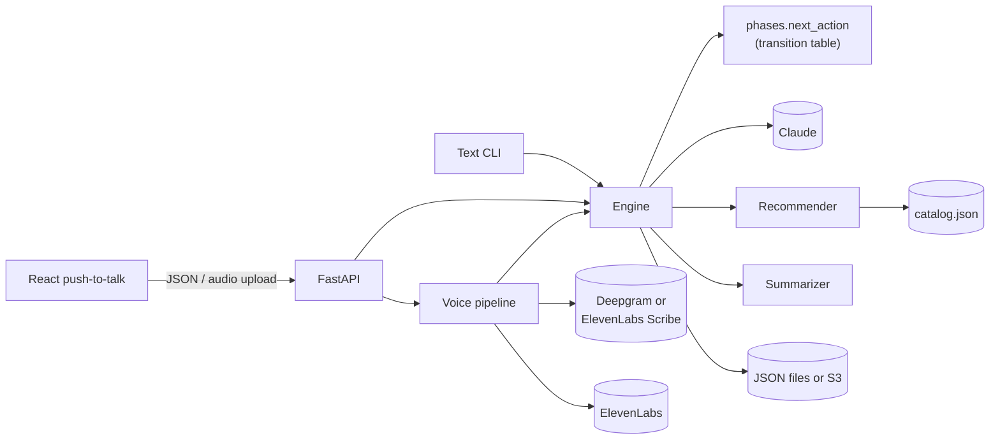

# Arcanum Academy Advisor

A conversational agent for a fictional business: the student advisor of a school of magic. It runs a short spoken or typed interview, collects and validates a student profile, checks which clubs and advanced classes the student is eligible for, and recommends the best fits. Every conversation is stored as a JSON record with a summary for school staff.

- **Text:** a terminal chat (`make run-text`).
- **Voice:** a React page with push-to-talk, recording from the browser's microphone (`make serve` + `make frontend`).
- **Models:** Claude (`claude-opus-5-5` by default) for understanding and replies, Deepgram Nova-3 (or ElevenLabs Scribe) for speech-to-text, ElevenLabs Flash v2.5 for text-to-speech.

**Demo video:** [Demo](https://docs.google.com/videos/d/1XJz-6PwYNbZdLOAcRiPB_NmtQMac2PRWj5DKukQusxE/play?usp=sharing)

---

## Contents

1. [Requirements coverage](#requirements-coverage)
2. [Setup](#setup)
3. [Architecture overview](#architecture-overview)
4. [Key design decisions](#key-design-decisions)
5. [Scalability](#scalability)
6. [Potential improvements](#potential-improvements)
7. [Known limitations](#known-limitations)
8. [Project layout](#project-layout)

---

## Requirements coverage

| Requirement | How it's met |
|---|---|
| Natural conversation that collects specific information | Six fields: school year, specialization, interests, magic orientation, learning style, weekly free hours. The bot asks one or two at a time, accepts several in one answer, handles corrections and lets the student skip optional questions. |
| Extract and validate into a structured format | One structured-output call per turn returns the extracted values, intent, sentiment and language. Each value is validated on its own with Pydantic; invalid ones are explained and asked again. |
| Handle errors and invalid input gracefully | See [Graceful degradation](#6-every-failure-has-a-defined-behaviour). |
| Maintain context | The full transcript is sent on every turn, along with the interview state (phase, known values, pending fields, errors). |
| Store conversations and data as JSON | One record per conversation: transcript, profile, errors, sentiment, recommendations, summary. Local files or S3. |
| Data validation | Profile fields, the catalog, settings, API requests and LLM outputs are all Pydantic models. |
| Summary with key points | Written when the conversation ends: 3–6 key points for school staff. |
| Python, LLM, STT and TTS of choice | Python 3.12, Claude, Deepgram or ElevenLabs Scribe, ElevenLabs. |
| **Bonus:** RAG over a knowledge base | A 15-entry catalog: metadata filtering in Python, LLM ranking over the eligible entries only, names checked against the catalog, catalog descriptions used to answer follow-up questions. |
| **Bonus:** sentiment / frustration | Labelled every turn; after two frustrated messages the bot gets brief, acknowledges it, and offers to skip optional questions or finish. The summary reports it. |
| **Bonus:** multi-turn memory | The conversation history and state across turns, including corrections after the recommendations. |
| **Bonus:** multiple languages | The bot replies in the student's language; the consent and fallback messages exist in English and Spanish, and the browser's language picks the first message. |

## Setup

### Prerequisites

- Python 3.12 and Node.js 20+
- An Anthropic API key (required)
- Deepgram and ElevenLabs API keys (optional, for voice). Without them, text works everywhere and replies have no audio. ElevenLabs alone also works: set `STT_PROVIDER=elevenlabs`.

### Install and run

```bash
cp .env.example .env            # then add your keys
make install                    # creates .venv, installs pinned versions from requirements/dev.lock
                                # (use `make install PYTHON=/path/to/python3.12` if needed)

make run-text                   # chat in the terminal; ARGS=-v shows phase, profile and LLM calls

make serve                      # API on http://localhost:8000
make frontend                   # in another terminal: voice UI on http://localhost:5173
```

Open http://localhost:5173, press **Start**, then hold the button (or the Space bar) while you speak. The panel on the right shows what the advisor has understood, live. The browser only allows the microphone on `localhost` or over HTTPS.

Keys and settings are read once at startup: after editing `.env`, restart `make serve` and reload the page.

### Checks

```bash
make lint typecheck test        # ruff, mypy --strict, 268 tests (99% coverage, fails below 90%)
make frontend-build             # TypeScript check and production build
```

The tests make no network calls: the LLM, speech providers and S3 are replaced by fakes or mocks. GitHub Actions runs the same checks on pushes to `main` and on pull requests.

### Main settings

Every setting is listed with its default in [.env.example](.env.example); a test fails if one is missing there.

| Setting | Default | Purpose |
|---|---|---|
| `ANTHROPIC_MODEL` / `LLM_EFFORT` | `claude-opus-5-5` / `low` | Model and reasoning effort |
| `STT_PROVIDER` | `deepgram` | `deepgram` or `elevenlabs` |
| `STORAGE` | `file` | `file` (`CONVERSATIONS_DIR`) or `s3` (`S3_BUCKET`, needs the `aws` extra) |
| `MAX_INPUT_CHARS`, `MAX_RECOMMENDATIONS`, `FRUSTRATION_STREAK` | 2000, 3, 2 | Interview behaviour |
| `LOG_FORMAT` | `text` | `json` for one object per line |

## Architecture overview



The **engine** is the core and keeps no state between calls: it takes a conversation id and a message, and returns the reply plus the updated record. The CLI, the HTTP API and the voice pipeline are thin layers around it. Every external service sits behind an interface (`LLMClient`, `STTClient`, `TTSClient`, `ConversationRepository`), and [bootstrap.py](src/agent/bootstrap.py) is the only place that turns settings into concrete classes.

### One turn

1. Load the record and work on a copy. If anything fails, the stored conversation is untouched and the student can repeat themselves.
2. Reject empty or oversized input with a fixed reply, without calling the LLM.
3. Call Claude once with structured output: extracted values, reply, intent, refused fields, sentiment, language.
4. Validate each extracted value against the profile model; keep the valid ones, record the errors for the next turn.
5. `next_action(phase, intent, changed, ready)` decides what happens: reply, start collecting, confirm the profile, recommend, or end.
6. Carry out the action. Confirming, recommending and summarizing are separate LLM calls, so the student always sees what's actually stored.
7. Save, rejecting the write if another request changed the conversation meanwhile.

### Phases

`consent → collecting → confirming → done`. The whole transition table is one pure function in [phases.py](src/agent/engine/phases.py), tested for every phase and intent.

| Phase | Student says | Next |
|---|---|---|
| consent | yes / no | collecting / done (declined) |
| collecting | answers, skips optional questions | confirming once every field is answered or skipped |
| confirming | yes / a correction / "that's wrong" | recommend → done / confirm again / collecting |
| done | follow-up questions / a correction | answered from the catalog / confirming again |
| any | "stop" | done (stopped), with a summary |

### Stored record

One JSON document per conversation, shortened here:

```json
{
  "id": "d926e1678de7491bb3b941102fb9086d",
  "version": 6,
  "phase": "done",
  "end_reason": "completed",
  "language": "en",
  "transcript": [
    { "role": "agent", "text": "Welcome to the Arcanum Academy advisor! … Shall we begin?", "timestamp": "2026-10-09T10:01:03Z" },
    { "role": "student", "text": "yes, let's go", "timestamp": "2026-10-09T10:01:03Z" }
  ],
  "profile": {
    "school_year": 4, "specialization": "DEFENSE", "interests": "dueling and protective wards",
    "magic_orientation": "POWER", "learning_modality": "PRACTICAL", "weekly_free_hours": 5.0
  },
  "field_errors": {},
  "skipped_fields": [],
  "sentiment_history": ["neutral", "neutral", "positive", "neutral", "positive"],
  "recommendations": [
    { "name": "Dueling Circle", "reason": "Ranked one-on-one practice for a power-driven, hands-on duelist." },
    { "name": "Ward Crafting Seminar", "reason": "Builds on your interest in protective wards." }
  ],
  "summary": [
    "Fourth-year Defense student, power-driven, learns hands-on, 5 free hours a week.",
    "Interested in dueling and protective wards; positive throughout.",
    "Recommended Dueling Circle and Ward Crafting Seminar."
  ],
  "model": "claude-opus-5-5",
  "prompt_version": "v3"
}
```

### HTTP API

| Endpoint | Purpose |
|---|---|
| `GET /health` | Status, which speech providers are configured, input limit |
| `POST /sessions` | Start a conversation (`speak`, `language` optional) |
| `GET /sessions/{id}` | The conversation, without storage details |
| `POST /sessions/{id}/messages` | Text turn |
| `POST /sessions/{id}/audio` | Voice turn: speech-to-text → engine → text-to-speech |

Every turn returns the reply, optional base64 audio, the transcript of what was heard, and the current phase, profile, errors, recommendations and summary. Interactive docs are at http://localhost:8000/docs. The frontend's TypeScript types are generated from the OpenAPI schema (`make api-types`), and a test fails if they fall out of date.

## Key design decisions

### 1. Python owns the flow, the LLM owns the language

The LLM extracts values, labels the turn and writes replies, but it never decides the phase. Phase changes come from a deterministic transition table. That keeps the flow predictable, makes every path testable without a model, and stops the model from, for example, recommending before the profile is confirmed.

### 2. Loose extraction, strict validation

The LLM's extraction schema uses plain strings, not enums. If a student says their specialization is "necromancy", Claude reports exactly that and validation rejects it with a reason the bot explains. With enums in the schema, Claude would be forced to pick a wrong valid option instead. Each field is validated on its own, so one bad value never discards the good ones in the same message.

### 3. One definition of the profile

`StudentProfile` defines each field once: type, limits, description, and whether it can be skipped. The prompt's field list, the required/skippable rules and the frontend's types are all derived from it, and tests keep the remaining copies (extraction schema, per-language labels) in sync. Adding a field doesn't mean hunting through the codebase.

### 4. Grounded recommendations (lightweight RAG)

Eligibility rules (school year, free hours, excluded specializations) are applied in Python, so the LLM never sees, and can't recommend, a club the student can't join. The LLM ranks only the eligible entries and must use their exact names; any name not in the filtered list is dropped. If the LLM fails or invents a name, a deterministic ranking by orientation and learning style takes over. Follow-up questions are answered from the recommended entries' catalog descriptions, and the bot is told to say when the answer isn't there.

With 15 entries, putting the eligible ones in the prompt is simpler and more accurate than vector search. Embeddings are listed under improvements for a larger knowledge base.

### 5. Turns are copy-on-write, saves are conditional

A turn works on a copy of the record and saves only at the end, so a failure never leaves a half-updated conversation. Each record has a version; saving a stale copy is rejected (HTTP 409). On S3 this uses conditional writes (`IfNoneMatch` / `IfMatch`), so it's safe across server processes and Lambda instances without locks.

### 6. Every failure has a defined behaviour

| Failure | What the student sees |
|---|---|
| Empty or too-long message | A fixed "say that again" / "shorter please", no LLM call |
| Invalid value ("year 9") | The bot explains the valid range and asks again |
| LLM timeout, rate limit, server error | SDK retries; then "please repeat that", conversation unchanged |
| LLM output doesn't match the schema | One automatic retry with the validation error |
| Model refusal | Server-side fallback to another model; otherwise a fixed reply |
| Recommendation call fails or invents a club | Deterministic ranking, fixed message in the student's language |
| Summary call fails | Nothing: the turn succeeds, the summary stays empty |
| Unclear audio or speech-to-text failure | Asked to repeat; conversation unchanged |
| Text-to-speech failure | The reply is shown as text |
| Two messages at once on one conversation | The second gets HTTP 409 |
| Storage unavailable | HTTP 503, no internal details |
| Missing or invalid API key | A clear configuration error in the CLI; HTTP 503 from the API |

### 7. Prompts built for caching and safety

The interview's system prompt never changes. The per-turn state travels with the student's latest message, so everything before it is identical on the next turn, and the Claude adapter marks that prefix for prompt caching: from the second turn on, the system prompt and history are read from cache instead of being re-processed. The student's words are wrapped in their own tag and the prompt treats them as content, never as instructions.

### 8. Swappable providers

Each external service is an interface with a fake used in tests. The speech-to-text provider is one setting (`STT_PROVIDER`), and storage is another (`STORAGE`). Adding an LLM provider means writing one adapter. All defaults live in [config.py](src/agent/config.py); adapters have none of their own, so there is exactly one place to change a model name or timeout.

### 9. Voice on top of a text engine

The engine only handles text. Voice is a pipeline around it, and the browser records push-to-talk clips that are uploaded in one request. The engine, and every test, works without audio; the demo gets real voice without streaming infrastructure.

### 10. Model choice

Claude Opus 5.5 at low effort: reliable structured output and good handling of slang, code-switching and corrections, with low latency for chat. The model is a setting; Claude Sonnet 5.5 costs half as much and is the obvious candidate if it holds quality (see improvements).

### 11. Observability

Logs carry the conversation id and a request id (returned as `X-Request-ID`) on every line, in text or JSON. Each LLM call logs latency, input/output and cache tokens, and the request id; each voice turn logs time spent in speech-to-text, the engine and text-to-speech.

## Scalability

- **The engine keeps no state between calls.** Any instance can serve any request; the conversation lives in the repository.
- **Storage is behind an interface.** Local JSON files for development; S3 with conditional writes for multiple instances. DynamoDB would be another implementation of the same interface.
- **Cost per turn is kept down.** Prompt caching re-uses the conversation prefix, and the catalog filter keeps the ranking prompt small. (There's no limit on turns per conversation yet; see improvements.)
- **AWS deployment (designed, not yet deployed):** the same app behind API Gateway on Lambda (container image), conversations in S3, keys in Secrets Manager, the React app on S3 + CloudFront. See [PLAN.md §5](PLAN.md#5-aws-deployment).

Limits today: endpoints are synchronous (fine on Lambda, one request per instance; a long-running server is bound by its thread pool), and file storage is only safe with a single server process.

## Potential improvements

In rough priority order:

1. **Bound latency and cost per turn:** a deadline shared by all calls in a turn (API Gateway cuts requests at 29 s), a maximum number of turns per conversation, and writing the summary in the background.
2. **Authentication and rate limiting** before any public deployment: today anyone with a conversation id can read it, and every request spends LLM and speech credit.
3. **Safe client retries:** the client sends the version it last saw, so a retried request can't apply a turn twice.
4. **An evaluation set against real models:** replay scripted conversations (slang, code-switching, corrections) and score extraction, intent and language per model, plus cost and latency. This would settle Opus vs Sonnet with numbers.
5. **Streaming voice:** streaming speech-to-text, LLM output and text-to-speech over a WebSocket would cut the 1–3 s per-turn delay.
6. **Async adapters** (`AsyncAnthropic`, async `httpx`) for long-running servers.
7. **Vector search** for a larger knowledge base, or a catalog-lookup tool the model can call during follow-ups.
8. **A business-agnostic engine:** move the persona and fixed texts into an injected prompt set, so the same engine runs another business's interview.
9. **More languages** for the fixed messages, and a local model adapter (e.g. Ollama) for offline use.
10. **Frontend tests** with a `useConversation` hook and Vitest or Playwright.
11. **Deploy** the AWS design, with a Dockerfile built from `requirements/runtime.lock`.

## Known limitations

- Only English and Spanish have fixed messages; other languages get those few messages in English (the LLM's replies are always in the student's language).
- The prompts are tuned on manual runs, not an evaluation set.
- No authentication, rate limiting or data-retention policy yet.
- Voice adds 1–3 s per turn because the steps run one after another.

## Project layout

```
src/agent/
├── config.py, bootstrap.py      settings; builds every component from them
├── logging_config.py            text/JSON logs with conversation and request ids
├── domain/                      profile, conversation record, catalog and eligibility filter
├── engine/                      engine, transition table, prompts, messages, recommender, summarizer
├── llm/                         LLMClient interface, Claude adapter, fake
├── speech/                      STT/TTS interfaces, Deepgram, ElevenLabs, voice pipeline, fakes
├── storage/                     repository interface, JSON files, S3
└── interfaces/                  CLI and FastAPI
data/catalog.json                the knowledge base (15 clubs and classes)
frontend/                        React push-to-talk UI with generated API types
tests/                           268 tests, no network
```

[PLAN.md](PLAN.md) has the detailed design; [SPECT.md](SPECT.md) is the scoped specification for this assignment.
